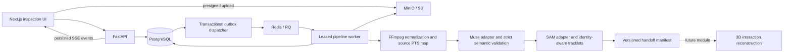

# First-layer architecture

This repository implements the foundation and Module A of the supplied blueprint,
plus the durable orchestration subset of Module D. Its output is semantic plans
and identity-aware **2D** perception, not robot actions or a physically validated dataset.

The fixture provider generates explicitly synthetic semantics and segments only the
known fixture colors. The live provider uses Meta Files/Responses and the official
SAM grammar parser. They have separate cache namespaces. There is no automatic
fallback from live to fixture mode. No paid requests are needed for setup or tests.

## Contracts and boundaries

Pydantic models in `packages/schemas/models.py` are canonical. JSON Schema and
generated TypeScript are checked in under `packages/schemas/generated` and
`apps/web/src/generated`. The version is `0.1.0`; breaking field/meaning changes
require a new contract version and explicit migration. Extra model-output fields,
nonfinite values, invalid references, and cyclic graphs fail validation.

Semantic `entity_id` describes the actor/object in a task. Internal `track_id`
describes a candidate's continuity within a shot and uninterrupted observation run.
Provider ordinals are scoped to a response, never global identity. Multiple matches
remain ambiguous until corrected. Missing runs split reappearance tracklets;
hard cuts always split them. The code does not claim semantic identity across cuts.

Coordinates are normalized video pixels, x right and y down, with top-left origin.
Boxes and shot ranges are half-open. Frames start at zero; timestamps are seconds
from normalized video start. Original source PTS are retained separately.
FFmpeg autorotation and aspect-preserving resizing happen before model calls.
The source mapping models the configured `fps:round=near` selection rule and is
verified against FFmpeg-generated VFR media in the test suite. No source frames are
deleted: dropped/duplicated fields describe normalization sampling only.

Mask storage is gzip JSON bundles containing `row-major-rle-v1` arrays. Counts
alternate zero and one runs, starting with zero, across row-major flattened pixels.
`mask_ref` is `object-key#frame/provider-id`. Parquet carries references and typed
metadata, not raster blobs. SAM's box-local raster is expanded at its documented
half-open bounds, rather than stretched over the full frame.

## Durability and reproducibility

Video creation and processing are separate. `complete-upload` verifies size, SHA-256,
duration and decoded source timestamps before any model call. Presigned PUTs are
conditional (`If-None-Match: *`), so a client cannot replace a validated source.
The local database uses explicit migrations; API state never lives only in memory.

A processing transaction creates both the job and an outbox entry. The dispatcher
delivers at least once to RQ. Atomic database leases prevent concurrent duplicate
execution. Workers heartbeat every 20 seconds; expired 90-second leases are
reconciled. The next delivery resumes completed stages or reuses immutable cache
artifacts. Stage runs are bounded to three attempts. Cancellation revokes the lease,
preventing an in-flight worker from publishing subsequent references. An external
model request already in progress may finish and be billable after cancellation.

Each attempt has its own artifact prefix. Artifact writes are conditional and hash/
length checked before metadata publication. Failed-attempt objects may remain
unreferenced for later lifecycle cleanup; they are never treated as successful.
Cache keys include source, stage, frozen config, schema/code hashes, model names,
mode and applicable corrections. Unknown provider revisions stay explicitly null.
Corrections create a new run with a source-run link and reuse preprocessing and
semantic artifacts while invalidating tracking. Original model output is retained.

Model intent is recorded before a request. Completed response payloads can be reused
after an interrupted stage. A timeout after transmission has an unknown outcome;
automatic replay is blocked to avoid silent double billing. Definite transient HTTP
failures use three bounded attempts. This cannot guarantee exactly-once billing
without provider-supported idempotency; inspect provider IDs for unknown outcomes.

## Gates and downstream handoff

The handoff links normalized media, source frame map, shots, semantic plan, graph,
tracks, mask bundles and diagnostics. `ready_for_geometry` requires measured,
associated coverage above a configurable-in-code, uncalibrated 80% gate, no unresolved
associations/cuts, no semantic warnings, and live rather than synthetic inference.
The report explains failed checks; `NEEDS_REVIEW` still preserves useful artifacts.
Coverage is a first-layer heuristic, not an estimate of physical correctness.

Geometry will consume these artifacts and add coordinate transforms, hand/object
poses, scale evidence and contact fusion. Physical boundary refinement, ITR,
robotization, simulation and standard robot-dataset export are downstream work.
`metric_scale_valid=false` and `certification=2d_perception_only` are unconditional here.

## Development scope

This is a single-project local service bound to loopback by Docker Compose. It has
no login, tenant isolation or public deployment. The example credentials are local
development values. Secrets are read server-side from environment variables.
Do not expose these ports publicly. Keep the original video and its rights provenance
separate from generated artifacts. The three real golden clips are explicitly marked
missing until imported; synthetic tests are never counted as model evaluation.

MinIO's old public images are unavailable. `infra/Minio.Dockerfile` builds the pinned
official `RELEASE.2025-09-07T16-13-09Z` source rather than using an unofficial mirror.
This local compatibility dependency is separate from production storage selection.
