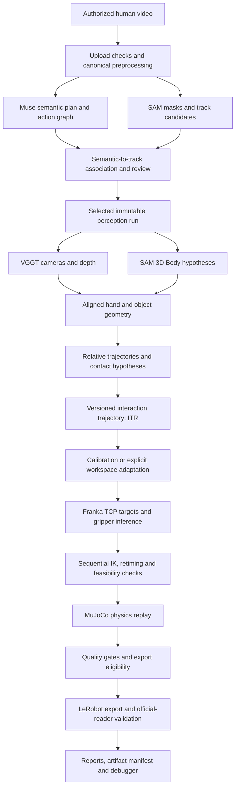

# Video2Robot: architecture, workflow and operating procedure

This guide explains the implementation through Phase 3 and how to operate it.
Status reflects the verification recorded by 4 November 2026. Consult the linked
machine-readable reports for individual runs; this guide is not a new test result.

## 1. Purpose and current status

The application converts a human manipulation video into a **candidate robot
demonstration**. It combines semantic understanding, visual tracking, reconstructed
geometry, contact hypotheses, robot retargeting, physics replay and dataset export.

The software is implemented through Phase 3. Real Muse, SAM, VGGT and SAM 3D Body
have executed. Franka IK, MuJoCo replay and official LeRobot export have passed
independent tests using synthetic known motion. The current real pouring video
has **not** passed the complete baseline: identity associations remain unresolved,
continuous associated hand geometry is absent, and the proxy simulation scene does
not establish task success. These are different levels of evidence.

## 2. End-to-end data flow



This is a dependency diagram. Actual jobs contain validation, review and failure
branches. Missing prerequisites may stop processing or leave diagnostic outputs.

## 3. What each service does

| Component | Responsibility | Main location |
| --- | --- | --- |
| Next.js frontend | Upload, run selection, masks/actions, geometry inspection, robot diagnostics and downloads | `apps/web/` |
| FastAPI backend | Validate requests, create jobs, expose status/results and artifact access | `apps/api/` |
| PostgreSQL | Persist videos, immutable runs, jobs, events, lineage and artifact metadata | `apps/api/db.py` and migrations |
| Outbox dispatcher | Deliver committed processing requests to the queue | `apps/api/orchestration.py` |
| Redis/RQ | Queue background work | Compose Redis and worker services |
| Worker | Execute stages with leases, heartbeats, retry limits and cancellation fencing | `workers/` |
| MinIO/S3 | Store original/normalized media, masks, geometry, replay and datasets | Compose MinIO service |
| FFmpeg/FFprobe | Validate media, normalize video and support timestamp mapping | Media preprocessing code |
| Muse adapter | Real semantic inference and strict output parsing | `packages/meta_client/` |
| SAM adapter | Real mask/tracking inference and provider-output parsing | `packages/meta_client/` and tracking workers |
| Geometry runtime | Actual VGGT and supported SAM 3D Body inference | `workers/geometry/gpu_entry.py` |
| Geometry/interaction code | Frame transforms, alignment, relative motion, contact fusion and ITR | `packages/geometry/`, `workers/interaction/` |
| Robot compiler | Franka FK/IK, retargeting, gripper commands, timing, replay, quality and export | `packages/robot/` |
| Canonical schemas | Validate Python contracts; generate JSON Schema and TypeScript | `packages/schemas/` |

The browser never needs the server's Meta API key. Hosted Muse/SAM inference and
local geometry inference use separate integrations. Hugging Face approval permits
checkpoint access; it does not create a hosted geometry inference endpoint.

## 4. Phase 1: video to semantic and visual observations

### Upload and preprocessing

The application stores the original video and validates upload size, checksum,
duration and media decoding before inference. FFmpeg creates the canonical video
timeline, preserving mapping to original source timestamps. Downstream frames,
actions, masks and trajectories refer to this common timeline.

Preprocessing is only the first part of Phase 1. The previous 22.88-second test
source took 604.188 seconds for the **entire** live phase, including model calls
and CPU mask decoding. A separate preprocessing duration has not been verified.
These measurements are examples, not a latency guarantee.

### Muse: what appears to happen

Muse identifies semantic entities, action intervals and dependencies. An example
is a hand grasping a glass, pouring into a bowl, then stirring with a spoon.
The parser validates structure, references and the action graph. A valid response
means it satisfies the contract; it does not prove semantic accuracy or contact.

### SAM: where visible entities are

SAM supplies mask observations and tracking candidates. The application records
tracklets and attempts to associate them with Muse entities. A semantic entity
ID and a visual track ID serve different purposes. Provider ordinals are scoped
to their response and cannot safely serve as permanent object identities.

Occlusions, missing observations and shot cuts can break continuity. The system
retains uncertainty rather than silently joining tracks by ordinal. Use the UI
to inspect masks at several times, especially action boundaries and occlusions.
Corrections create a new run and preserve the original outputs and provenance.

Phase 1 hands off canonical media, frame mapping, shots, semantics, action graph,
tracks, masks and readiness diagnostics. `NEEDS_REVIEW` preserves useful outputs;
it is not a declaration of correct identities.

## 5. Phase 2: observations to interaction trajectories

Phase 2 consumes a selected immutable perception run. VGGT estimates cameras and
depth on sampled frames. SAM 3D Body, when enabled, supplies body hypotheses that
can support anatomical wrist observations when identity and alignment are valid.
The pipeline aligns compatible outputs and derives object geometry from masked
surface observations.

The result can include camera/depth outputs, associated hand/object samples,
object-relative motion, contact candidates and refined action intervals. The
versioned ITR bundles the interaction information for Phase 3.

Several distinctions matter:

- A visible-surface centroid is not necessarily the physical object center.
- A PCA orientation is a pose hypothesis and may be degenerate or ambiguous.
- A raw body hypothesis is not automatically an associated manipulating hand.
- Reprojection consistency is a diagnostic, not independent 3D ground truth.
- Monocular relative scale is not a measurement in meters.
- Missing geometry must remain missing; contact loss cannot be inferred solely
  from loss of observation.

The active Linux geometry runtime is mounted from `E:/MetaAIHack-models` at
`/models`. It uses downloaded, hash-verified official checkpoints and pinned source
code. The worker has tested NVIDIA GPU access. On the 4 GiB RTX 3050 Ti, use
**Limited-memory preview**: four sampled frames at 224-pixel input resolution.
VGGT uses reduced-precision CUDA aggregation and FP32 camera/depth heads on CPU.
This is real inference, but sparse previews may be inadequate for robotization.

The recorded queued test produced four cameras and four raw body hypotheses,
with all 53 artifact hashes verified. Inference took 183.213 seconds; overall
submission/artifact verification took 317.156 seconds. It produced zero associated
hand-pose rows because source identities remain unresolved. See
[geometry runtime](geometry-runtime.md) for versions, hashes and reproduction.

## 6. Phase 3: interaction trajectories to robot commands

### Task selection and calibration

Select one manipulating hand, object, shot and continuous interval. Intervals must
have sufficient associated geometry and cannot bridge unsupported identity/world
changes or excessive gaps. Two-hand tasks need an explicit valid single-arm scope.

`workspace_adaptation` centers and rescales observed motion into a configured robot
workspace. It supports exploration without known dimensions while recording that
the original physical scale is unknown. `measured` calibration accepts supplied
scale, scene-to-base transform and evidence/residual information. Supplying fields
does not independently validate the measurement or the grasp.

### TCP targets and gripper inference

Retargeting constructs tool-center-point targets using hand positions during free
motion and object translation plus a contact-onset hand offset during coupled
contact. TCP orientation is an explicit task constraint; unknown source orientation
is not silently converted into a measured quaternion.

Temporal contact and compatible motion can infer close/hold; observed no-contact
can support open. Unknown observations remain unknown. Initial gripper settings,
width defaults and task offsets are assumptions when configured, not measurements.
Unknown widths cannot silently become valid zero-width training actions.

### Franka FK, IK and timing

The actual Panda model/assets are pinned and hashed. MuJoCo provides forward
kinematics and modeled collision detection. Bounded numerical IK seeks seven-joint
solutions with task-space residuals, warm starts, continuity regularization and
collision penalties. It is a local solver, not a globally complete motion planner.

Quintic joint segments are retimed against configured velocity/acceleration limits.
The derived path is checked again. Every command retains source time separately
from robot execution time, target/achieved TCP, joints, derivatives, gripper state
and invalid reasons. This mapping synchronizes source and replay inspection.

### Physics replay

MuJoCo advances physics with commanded controls and records simulated state.
Reports distinguish commanded targets from measured simulated joints/TCP and retain
tracking errors and checked violations. Replay video is a useful inspection aid;
animation alone would not establish physics validity.

The current scene uses declared proxies and assumed properties. It does not
establish successful real-world grasping, placement or fluid transfer. No physical
robot telemetry or hardware execution is claimed.

### Quality and dataset export

Quality reports apply the implemented Gold/Silver/Reject rubric with reason codes.
Missing mandatory evidence cannot pass. Review overrides permit exploration while
retaining uncertainty and do not confer certification.

Eligible commands can be written using the official LeRobot 0.4.1/v3 writer and
reloaded with its official reader. Validation checks rows, timestamp ordering,
feature shapes, action/joint ordering, finite values, alignment and video decoding.
Simulation-derived observations remain labeled simulated. Diagnostic export and
accepted training data are distinct. Unknown gripper commands can block export.

## 7. Runs, caching, contracts and provenance

| Term | Meaning |
| --- | --- |
| Video | Uploaded source and its provenance |
| Run | Immutable processing configuration and lineage |
| Job | Scheduled execution and status for a run |
| Attempt | One bounded execution attempt with separate artifact paths |
| Artifact | Stored output with checksum and metadata |
| Handoff | Manifest linking outputs, readiness and source lineage |
| Idempotency key | Identifies a submission so retrying it can retrieve the same request |

Database transactions and the outbox avoid losing committed work between the API
and queue. Leases/heartbeats prevent competing workers from publishing the same
execution. Cancellation fences later publication, although an already-sent external
request may finish and be billable. Unknown model-request outcomes are protected
against blind replay. This is not an exactly-once billing guarantee.

Stage caches include relevant source/configuration, code/schema, model and asset
identities. Reused results retain lineage and must be labeled cached. Live and
fixture namespaces are separate; there is no automatic live-to-fixture fallback.

Pydantic is canonical. Phase 1, 2 and 3 contracts use versions 0.1.0, 0.2.0 and
0.3.0 respectively. JSON Schema and TypeScript keep backend/frontend boundaries
consistent. Typed Parquet carries tabular outputs; large media and masks are
stored as referenced artifacts.

## 8. Operating procedure

Run commands from the repository root. Docker Desktop must be running; retain the
configured ignored `.env`, external model directory and local source checkouts.

```powershell
docker compose -f compose.yaml -f compose.robot.yaml -f compose.geometry.yaml up -d
npm.cmd start
```

Open **http://127.0.0.1:53000**. API documentation is at
**http://localhost:58000/docs**. If frontend code changed, run `npm.cmd run build`
before `npm.cmd start`. Do not start a duplicate frontend if it is already running.

1. Confirm the workspace is in **LIVE** mode.
2. Upload authorized footage, or select an existing perception run to reuse results.
   `data/golden/pouring.mp4` is the existing licensed test source.
3. Wait for Phase 1, then inspect actions, masks, identities and warnings. Correct
   associations where evidence supports a correction.
4. On the desired perception run, keep **Limited-memory preview** enabled and
   enable **Use SAM 3D Body for anatomical wrists**. Click **Run phase 2**.
5. Inspect reconstruction/contact reports and `phase2_handoff.json`. An exploratory
   review override retains unresolved reasons; it does not repair the inputs.
6. Where valid associated geometry exists, select the hand/object/shot/interval,
   choose calibration mode and click **Run phase 3**.
7. Inspect source/robot timelines, target-versus-achieved TCP, gripper, replay,
   `quality_report.json`, `simulation_report.json`, `export_report.json` and handoff.
8. Confirm official-reader success before calling a dataset export verified. Read
   quality eligibility separately before using it as accepted training data.

The present pouring run needs identity correction and sufficient continuous
geometry before meaningful robotization. Repeating downstream work alone cannot
resolve missing upstream evidence.

## 9. Test commands and expected outcomes

### Service readiness and logs

```powershell
Invoke-RestMethod http://localhost:58000/health/ready
docker compose logs --tail 100 -f worker
```

Readiness should report `ready` and `live`. For failures, inspect the job error,
worker logs and stage reports rather than assuming the browser has stalled.

### Recheck the existing real geometry run

```powershell
.\.venv\Scripts\python.exe -m scripts.live_reconstruction_smoke `
  --key verified-real-geometry-v1 `
  --report eval/reports/local-geometry-check.json
```

The same key retrieves the existing job. A new key intentionally submits another
local model run. This command reuses recorded perception and makes no new hosted
Muse/SAM inference calls. Current source outcome is completed with review.

### Independent robot/simulation/export smoke

```powershell
docker compose -f compose.yaml -f compose.robot.yaml -f compose.geometry.yaml run --rm --no-deps worker `
  python -m scripts.smoke_robotization `
  --lerobot-python /opt/lerobot/bin/python `
  --report eval/reports/local-robot-smoke.json
```

This uses synthetic known motion with real robot/simulator/export components.
The recorded case passed 32 commands and official-reader round-trip. Its report
identifies output paths. It does not validate real-video perception or task success.

### Combined real-video acceptance

Edit `configs/robotization-example.json` to match the selected entities and interval:

```powershell
.\.venv\Scripts\python.exe -m scripts.baseline_acceptance `
  --phase1-report eval/reports/baseline-phase1-live.json `
  --low-vram `
  --robot-config configs/robotization-example.json `
  --idempotency-key local-full-test-001 `
  --report eval/reports/local-full-test.json
```

The controller reuses recorded Phase 1 and attempts downstream processing. A
nonzero exit denotes unmet acceptance requirements. Add `--run-perception` only
when intentionally requesting new bounded hosted calls. Example configuration is
not evidence that its selected interval is robotizable.

### Software checks

```powershell
docker compose -f compose.yaml -f compose.robot.yaml -f compose.geometry.yaml exec worker python -m pytest -q
npm.cmd run schemas:check
npm.cmd run typecheck
npm.cmd run build
```

The recorded worker regression suite passed 85 tests. Software/build checks and
live acceptance are distinct. Browser interaction has not been independently
verified; successful frontend build/HTTP responses do not replace that check.

## 10. Reading results correctly

| Observation | What it establishes |
| --- | --- |
| API is ready | Services are available, not that models are accurate |
| Model runtime completed | Actual inference executed, not that identities/geometry are correct |
| `NEEDS_REVIEW` | Useful outputs exist with unresolved conditions |
| IK passed | Checked kinematic targets are feasible under the configured model |
| Physics replay passed checked gates | Configured simulated checks passed, not physical task success |
| LeRobot round-trip passed | Dataset is readable and checked structurally/semantically as implemented |
| Accepted training subset | Published quality requirements passed for that output |

End-to-end acceptance requires all mandatory stages and checks on the **same
traceable real-video lineage**. Separate successful component tests do not add up
to that claim automatically.

## 11. Reference documents and evidence

- [Local testing runbook](live-testing.md): UI/CLI procedures and fixture integration.
- [Geometry runtime](geometry-runtime.md): active mounts, versions, hashes and GPU controls.
- [Phase 1 architecture](architecture.md): historical perception contracts and orchestration.
- [Phase 2](phase-two.md): geometry, contact and ITR details.
- [Phase 3](phase-three.md): robot compiler, calibration, quality, replay and export.
- [Baseline acceptance](baseline-acceptance.md): completed checks and outstanding requirements.
- [Latest real queued geometry report](../eval/reports/live-phase2-geometry.json).
- [Recorded real perception report](../eval/reports/baseline-phase1-live.json).
- [Independent robot container smoke](../eval/reports/phase3-container-smoke.json).

Credentials, checkpoints, source media, generated datasets and bulk raw model
outputs remain outside Git. A fresh checkout needs its own configured runtimes,
authorized assets and local configuration; the repository alone does not contain
the installed model environment.
