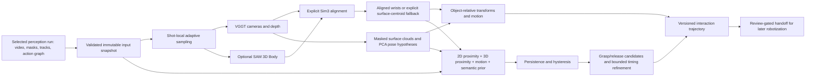

# Phase 2: 3D interaction reconstruction

Module B consumes a selected, immutable layer-one run. It builds hand/scene 3D,
object-relative trajectories, contact evidence and interaction primitives. It stops
at an Interaction Trajectory Representation (ITR); robot retargeting, IK,
simulation, dataset certification and LeRobot/RLDS export remain later work.



## Run it now

Start Docker Desktop, then run from the project directory:

```powershell
docker compose up -d
npm.cmd run dev
```

Open **http://127.0.0.1:53000**. Run the synthetic demo or select its completed
perception run, then click **Run phase 2**. The new panel shows rotating sampled
3D position paths, synchronized projected centroids on the original video, contact
channels, boundary candidates, provenance and review reasons. Unsampled geometry
stays explicitly missing; the viewer does not display interpolated observations.

The CPU fixture provider creates a synthetic relative scene, never real human
geometry. It can consume only fixture-mode perception. The source and outputs are
visibly labeled synthetic. There is no live-to-fixture fallback.

Run the reproducible HTTP/queue/storage acceptance test:

```powershell
.\.venv\Scripts\python.exe -m scripts.smoke_reconstruction
# Equivalent task runner command:
.\.venv\Scripts\python.exe -m scripts.tasks phase2-smoke
```

The smoke creates and uploads actual generated video, runs perception and phase 2,
checks every published artifact hash, validates ITR and all API contracts, tests
idempotency/config conflicts and cache reuse, and checks run-specific lineage.
It refuses live mode. Results are saved to `eval/reports/phase2-smoke.json`.
Pass `--source-job JOB_ID` to reuse a finished synthetic perception run.

## Live GPU runtime

The default CPU dependencies do not contain Torch, VGGT, SAM 3D Body, or model
weights. The live adapter is implemented, but was not executed with actual GPU
models in this environment. No checkpoints are downloaded automatically.

Use a separate Linux/CUDA Python environment with this project and the official
model packages installed. Follow the upstream setup instructions and supply local
checkpoints that you are authorized to use:

- [VGGT installation and inference](https://github.com/facebookresearch/vggt).
  The adapter constructs `VGGT`, loads a local state dictionary, infers depth and
  camera pose encoding, and decodes camera extrinsics/intrinsics.
- [SAM 3D Body setup](https://github.com/facebookresearch/sam-3d-body/blob/main/INSTALL.md).
  The adapter uses `load_sam_3d_body` and `SAM3DBodyEstimator.process_one_image`,
  preserves MHR keypoint names, and aligns these estimates with scene geometry.
- [SAM 3D Objects](https://github.com/facebookresearch/sam-3d-objects) remains
  optional. The implemented MVP object path uses masked depth clouds and principal
  orientation hypotheses; it does not claim an object mesh or CAD registration.

Set these server-side variables, using paths visible to the worker:

```text
GEOMETRY_PYTHON=/opt/geometry-venv/bin/python
VGGT_CHECKPOINT=/models/vggt/model.pt
SAM3D_BODY_CHECKPOINT=/models/sam3d-body/model.ckpt
SAM3D_MHR_PATH=/models/sam3d-body/assets/mhr_model.pt
```

The optional body paths are needed only when `body_backend="sam3d"`. The worker
calls `python -m workers.geometry.gpu_entry --request ... --output ...` as an
argument vector without shell interpolation. The GPU environment must import
`workers`, `packages`, OpenCV, NumPy and both selected model packages. The subprocess
uses the project working directory and offline Hugging Face settings. Mount the
runtime/checkpoints into the worker and expose CUDA, or run the existing RQ worker
in that Linux GPU environment against the same PostgreSQL, Redis and S3 services.
The standard CPU Compose file does not provision a CUDA image or GPU mounts.

Checkpoint SHA-256 hashes are frozen at submission and verified at execution.
Missing/changed files and inference failures return explicit errors. Local model
execution is recorded with model identity, config hash, duration, sampling usage,
raw report and failure logs. Model packages must be compatible with the official
APIs cited above; GPU execution and package-version compatibility still require
live acceptance. There is no remote GPU HTTP endpoint or invented hosted SAM 3D API.

## API

Submit a reconstruction with `POST /v1/videos/{video_id}/reconstruct`:

```json
{
  "source_job_id": "FINISHED_LAYER_ONE_JOB",
  "idempotency_key": "reconstruction-v1",
  "config": {
    "backend": "vggt",
    "body_backend": "sam3d",
    "sample_fps": 5,
    "max_frames_per_shot": 32,
    "max_total_frames": 96,
    "persistence_frames": 3
  },
  "allow_review_source": false
}
```

Use `backend="fixture", body_backend="none"` on synthetic perception. Live sources
with unresolved layer-one review reasons need an explicit `allow_review_source`
override for exploratory processing. Overrides do not remove the reasons.
Repeated idempotency keys return the same job; different source/config under the
same key is rejected. The source must be a completed perception run of this video.

Existing job/status, retry, cancellation, artifacts and persisted SSE endpoints
apply to phase 2. The phases are `geometry`, `interaction`, and
`interaction_trajectory`, preceded by an atomic `reconstruction_inputs` snapshot.
The same transactional outbox, leases, cancellation fencing and bounded stage
attempts are used. A completed source is never edited. Perception corrections must
target a layer-one job; reconstruct the corrected run afterward.

Read results with a `?run_id=...` selector:

| Endpoint | Result |
| --- | --- |
| `GET /v1/videos/{id}/geometry` | Cameras, hands, objects, object-relative poses and contacts |
| `GET /v1/videos/{id}/contacts` | Contact evidence windows |
| `GET /v1/videos/{id}/geometry-report` | Combined reconstruction/interaction diagnostics |
| `GET /v1/videos/{id}/refined-actions` | Original semantic intervals and separate candidate boundaries |
| `GET /v1/videos/{id}/phase2-handoff` | Immutable phase 2 artifact references and review gate |

Geometry/contact windows support shot/entity/time filters and frame pagination.
`offset` and `limit` count distinct canonical frames, not individual entity rows.
Bulk surface points are omitted from API responses unless `include_points=true`;
the full typed tables remain available as artifacts. Unavailable results return
`E_RESULT_PENDING`, distinct from successful empty windows.

## Artifacts and coordinate rules

Canonical Pydantic contracts are in `packages/schemas/reconstruction.py`, version
`0.2.0`. JSON Schema and TypeScript are generated alongside the preserved `0.1.0`
perception contracts. Typed Parquet schemas are derived directly from these models,
including nullable structs and variable-length coordinate arrays.

Outputs include:

```text
cameras.parquet
hand_pose.parquet
object_pose.parquet
object_centric.parquet
alignments.json
geometry_report.json
geometry_provenance.json
contacts.parquet
interaction_events.json
refined_actions.json
affordance_patches.json
interaction_report.json
interaction_trajectory.json.gz
reconstruction_report.json
phase2_handoff.json
```

Live runs also retain sampled depth/point-map arrays, preprocessing transforms and
GPU logs. These are compressed NPZ/JSON without pickle. Each stage writes a new
immutable run/attempt prefix. Geometry and contact cache keys include source artifact
hashes, frozen settings, checkpoint hashes and code hash. The ITR is run-specific
so its run ID cannot be inherited from another processing run.

Camera axes use OpenCV convention: x right, y down, z forward. Every shot has a
separate world frame. `world_from_camera` maps camera points into that shot's world.
Quaternions use xyzw and must have unit norm. `T_target_source` maps source into
target; `T_object_hand = inverse(T_world_object) @ T_world_hand`. Object increments
use `inverse(T_world_object_previous) @ T_world_object_current`. Relative translation
in world axes is stored separately when object orientation is unknown.

Geometry is in relative scene units. Intrinsics are transformed back through the
recorded letterboxing affine to normalized-video pixels; output depth/point maps
have the normalized video resolution. No camera interpolation crosses cuts.
Body estimates are associated with measured hand masks using projected hand joints;
ambiguous hands stay unassociated. Per-frame Sim(3) alignment requires sufficient,
non-collinear correspondences and acceptable normalized residual. Alignment method,
scale and residual are retained. Body inference currently uses a full-image person
hypothesis, not multi-person detection, and needs visual review.

Object poses are robust visible-surface centroids with PCA orientation hypotheses.
Symmetric/degenerate orientations remain null. These are not full amodal rigid-body
centers or CAD poses. Hand surface centroids are explicitly distinguished from
anatomical wrists. Sparse samples produce missing rows; velocity estimates describe
sample-to-sample changes within an associated tracklet. Reprojection diagnostics
compare projected estimates to mask centroids, which is a consistency check rather
than independent 3D ground truth.

## Contact and primitive semantics

Contact fusion combines measured-mask distance, aligned 3D surface distance,
recent hand/object motion coupling and semantic contact requirements. Missing
channels do not receive perfect scores or get renormalized away. Stationarity is
not evidence of a grasp. A semantic prior or mask overlap alone cannot establish
3D contact. The weighted score is uncalibrated, even though the frozen contract
calls its field `probability`.
Motion coupling currently uses image-plane tracks and is not camera-motion
compensated; camera panning can therefore produce a coupled-motion candidate.

Persistence and on/off hysteresis suppress one-frame spikes. At least two distinct
3D samples are required before contact can activate. Evidence resets at
cuts, identity changes and missing/ambiguous 2D observations. A recent 3D distance
can support neighboring frames for at most 0.25 seconds; these rows explicitly say
`geometry_origin="held"` and record its age. Losing 3D evidence cannot by itself
emit a release. Unknown is not a negative contact label.

Rising contact plus motion coupling yields a **grasp candidate**. Falling contact
yields a **release candidate**. Object support, force/contact and actual grasp
validity remain unverified, so `validated_grasp=false` is unconditional. Contact
patches are estimated nearest-surface points in the object's frame; they never
claim a semantic handle part or a validated grasp affordance without evidence.

GRASP/RELEASE/PLACE start candidates are searched within a bounded window around
Muse's original start. The semantic plan remains immutable. An unsupported detector
or absent transition preserves semantic timing; it does not invent a boundary.
Other primitive boundaries remain semantic. Candidate events do not silently change
gripper state, create robot actions, or establish measured physical contact.

The handoff carries all unresolved perception/geometry/contact reasons, with
`metric_scale_valid=false` and `ready_for_robotization=false`. Metric calibration,
support-state reasoning, real-video contact calibration and robot feasibility are
not bypassed by a successful software run.
